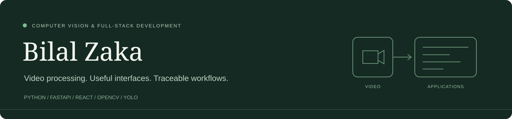

  

# Hi, I'm Bilal Zaka

**Computer Vision & Full-Stack Development** · Lahore

I build applications that connect video processing, backend APIs, and usable interfaces. My current project is **MT Project**, an original video surveillance prototype built around real detection, tracking, and reviewable incident evidence.

[Explore MT Project](https://github.com/BilalZaka37/mt-project) · [View the portfolio](https://bilalzaka37.github.io/mt-project/) · [Watch the workflow](https://bilalzaka37.github.io/mt-project/#workflow)

## Featured project — MT Project

A working full-stack computer vision prototype with:

- **Video sources:** RTSP/HTTP support and recorded-video processing, with per-source health and reconnection behavior.
- **Vision:** YOLO detection, ByteTrack IDs, and polygon-based intrusion rules.
- **Evidence:** event history, annotated snapshots, pre/post-event clips, recording playback, and operator acknowledgement.
- **Backend:** FastAPI, database migrations, role-based access, revocable sessions, authenticated media, and signed webhook retries.
- **Deployment foundation:** Docker and PostgreSQL configuration, tests, and documented architecture boundaries.

The portfolio includes an **87-second capture of the functioning application**, using public OpenCV footage and CPU inference. Physical-camera acceptance, GPU performance, and production-scale validation remain separate work. MT Project is an independent prototype developed with AI assistance; dependencies and public footage are credited in the repository.

[Architecture](https://github.com/BilalZaka37/mt-project/blob/main/docs/ARCHITECTURE.md) · [Executed validation](https://github.com/BilalZaka37/mt-project/blob/main/docs/VALIDATION.md) · [Run it locally](https://github.com/BilalZaka37/mt-project#portable-windows-setup)

## Technologies used in MT Project

| Area | Technologies |
| --- | --- |
| Computer vision | Python, OpenCV, Ultralytics YOLO, ByteTrack |
| Backend & APIs | FastAPI, SQLAlchemy, Alembic, Uvicorn |
| Frontend | React, TypeScript, Vite, CSS |
| Data | PostgreSQL deployment configuration, SQLite for local development |
| Media & delivery | FFmpeg, H.264 MP4, signed webhooks, persistent retries |
| Tooling | Docker, pytest, GitHub Actions configuration |

## Engineering focus

- Keep capture, recording, and inference measurable and independently observable.
- Make an incident explainable through its rule, track, timestamp, snapshot, and clip.
- Test failure and recovery paths alongside the normal workflow.
- Document demonstrated behavior and outstanding deployment validation clearly.

For questions about MT Project, [open an issue](https://github.com/BilalZaka37/mt-project/issues).
